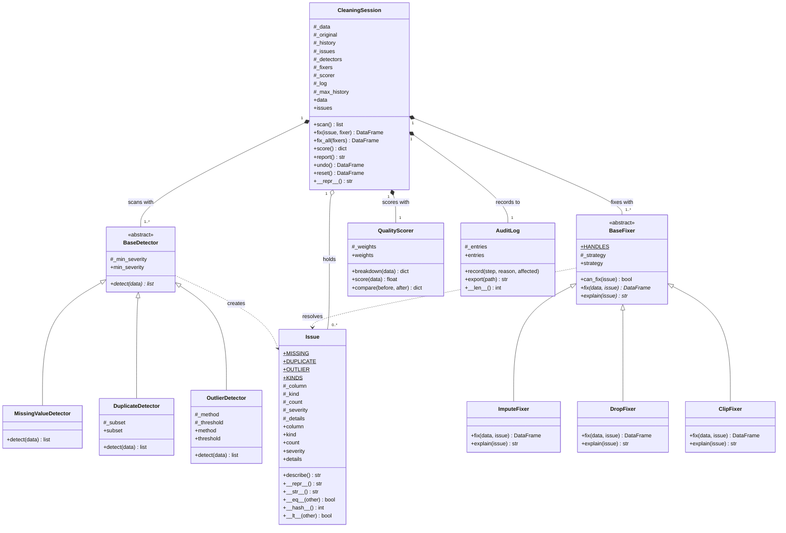

# MendData

**A beginner-friendly data cleaning library for pandas: scan, fix, score, and explain.**

MendData helps students and beginner analysts clean tabular data without guessing. It finds the problems in a DataFrame, fixes each one with a strategy you choose, scores the quality before and after, and explains every change in plain English.

> **Status: Phase 2 (core OOP development) is in progress.** The `Issue` class and the package setup are done. The detectors, fixers, scorer, audit log, and session are being built on feature branches. The API shown below follows the team's design contract and may still change. MendData is not on PyPI yet.

## Why MendData?

Anyone who has opened a real-world dataset knows how much time goes into fixing it before analysis can begin. Missing cells, repeated rows, and extreme values are easy to spot one at a time, but beginners rarely know how bad a dataset is, what was changed, or whether the cleaned version is actually better. MendData follows one simple order of work:

1. **Scan** the data for problems.
2. **Fix** each problem with a chosen strategy.
3. **Score** the quality before and after.
4. **Explain** every change in plain English.

## Features

| # | Feature | What it does |
|---|---|---|
| 1 | Issue scanning | Detects missing values, duplicate rows, and outliers (IQR or z-score), ranked by severity. |
| 2 | Strategy-based fixing | Resolves each issue by imputing (mean, median, mode), dropping, or clipping. You choose the strategy per kind of issue. |
| 3 | Data quality score | Rates the dataset from 0 to 100 using completeness, uniqueness, and validity. |
| 4 | Plain-English audit log | Records what each step did, why, and how much it affected. Exports as readable text. |
| 5 | Undo and step history | Reverts the last cleaning step, or resets to the original data. |

## Installation

MendData needs Python 3.9 or newer, plus `pandas` and `numpy`.

**From PyPI** (planned for Phase 5, not available yet):

```bash
pip install menddata
```

**For development:**

```bash
git clone https://github.com/yninika/MendData.git
cd MendData
pip install -r requirements.txt
pip install -e .   # works once setup.py is added in Phase 4
```

PyPI package names are not case-sensitive, so the package installs as `menddata` and is imported as `MendData`.

## Quick start

This is the planned usage. Methods return values and never print, so wrap them in `print()` to see them.

```python
import pandas as pd
from MendData import CleaningSession, ImputeFixer

df = pd.read_csv("messy_data.csv")

session = CleaningSession(df)     # wrap a pandas DataFrame
session.scan()                    # find issues, ranked by severity
session.fix_all()                 # default fixers: median fill, drop duplicates, clip outliers
print(session.score())            # quality score before and after
print(session.report())           # plain-English summary of changes
session.undo()                    # revert the last cleaning step
session.reset()                   # go back to the original data

clean_df = session.data           # a copy of the current data
```

To choose a strategy for one kind of issue, pass your own fixer:

```python
session.fix_all(fixers={"missing": ImputeFixer("mean")})
```

Each problem MendData finds is an `Issue` that describes itself. This works today:

```python
>>> from MendData.issue import Issue
>>> issue = Issue("age", Issue.MISSING, count=12, severity=0.06)
>>> print(issue)
Column 'age' has 12 missing values (6.0% of its rows).
>>> issue
Issue(column='age', kind='missing', count=12, severity=0.060)
```

## Class design (UML)

The design separates finding problems (detectors) from fixing them (fixers). `Issue` is the shared contract between the two, and `CleaningSession` ties everything together.



Diagram key: `+` public, `#` protected (one leading underscore in Python), `*` abstract method, `$` class-level constant. The same diagram is available as Mermaid code in [`docs/UML_class_diagram.mmd`](docs/UML_class_diagram.mmd) and as an image in [`docs/UML_class_diagram.png`](docs/UML_class_diagram.png).

## Class reference

This is the planned API from the team contract. Every class and method has a docstring.

| Class | Module | Key members |
|---|---|---|
| `Issue` | `issue.py` | `Issue(column, kind, count, severity, details=None)`. Read-only properties `column`, `kind`, `count`, `severity`, `details`. `describe()`. |
| `BaseDetector` | `detectors.py` | Abstract. Property `min_severity`. Abstract `detect(data) -> list[Issue]`. |
| `MissingValueDetector` | `detectors.py` | One issue per column that has missing values. |
| `DuplicateDetector(subset=None)` | `detectors.py` | One row-level issue for repeated rows. |
| `OutlierDetector(method='iqr', threshold=None)` | `detectors.py` | One issue per numeric column with outliers (IQR or z-score). |
| `BaseFixer(strategy)` | `fixers.py` | Abstract. `HANDLES`, `strategy`, `can_fix(issue)`, abstract `fix(data, issue)` and `explain(issue)`. |
| `ImputeFixer(strategy='median')` | `fixers.py` | Fills missing values with the mean, median, or mode. |
| `DropFixer()` | `fixers.py` | Drops duplicate rows, or rows with a missing value. |
| `ClipFixer()` | `fixers.py` | Clips outliers to the bounds the detector found. |
| `QualityScorer(weights=None)` | `scoring.py` | `breakdown(data)`, `score(data)`, `compare(before, after)`. |
| `AuditLog()` | `audit.py` | `record(step, reason, affected=0)`, `entries`, `export(path=None)`, `len(log)`. |
| `CleaningSession(data, ...)` | `session.py` | `scan()`, `fix(issue)`, `fix_all()`, `score()`, `report()`, `undo()`, `reset()`, `data`, `issues`. |

### The `Issue` contract

| Field | Meaning |
|---|---|
| `column` | The column label, or `None` for a row-level issue such as duplicates. |
| `kind` | `Issue.MISSING`, `Issue.DUPLICATE`, or `Issue.OUTLIER`. |
| `count` | How many values or rows are affected. |
| `severity` | A float from 0 to 1: the share of what was checked that is affected. Used to rank issues. |
| `details` | Extra facts for the fixer. Duplicates: `subset`. Outliers: `method`, `lower`, `upper`. |

An `Issue` cannot be changed after it is created. Rank issues with `sorted(issues, reverse=True)`.

### The quality score

The score (0 to 100) is a weighted mix of three parts. The default weights are 40% completeness, 30% uniqueness, and 30% validity.

- **Completeness**: how few cells are missing.
- **Uniqueness**: how few rows are repeated.
- **Validity**: how few numeric values fall outside the usual range (the 1.5 × IQR fences).

## Object-Oriented design

- **Encapsulation**: private attributes (such as `_severity`, `_strategy`, `_entries`) exposed through read-only properties. Properties that return lists or dicts return copies.
- **Inheritance**: three detectors inherit from `BaseDetector`, and three fixers inherit from `BaseFixer`. Both base classes are abstract.
- **Polymorphism**: every detector and fixer overrides the base-class methods, and `CleaningSession` calls them through the base-class interface. `Issue` also overloads `<` to rank issues by severity.
- **Dunder methods**: `__repr__`, `__str__`, `__eq__`, `__hash__`, `__lt__`, and `__len__`.
- **Composition**: `CleaningSession` is built from detectors, fixers, a `QualityScorer`, and an `AuditLog`.

## Project structure

```
MendData/                    (repository root)
├── MendData/                (the Python package)
│   ├── __init__.py          (version info and public exports)
│   ├── issue.py             (Issue)
│   ├── detectors.py         (BaseDetector, MissingValueDetector,
│   │                         DuplicateDetector, OutlierDetector)
│   ├── fixers.py            (BaseFixer, ImputeFixer, DropFixer, ClipFixer)
│   ├── scoring.py           (QualityScorer)
│   ├── audit.py             (AuditLog)
│   ├── session.py           (CleaningSession)
│   └── utils.py             (input validation helpers)
├── tests/
├── docs/
│   ├── UML_class_diagram.mmd
│   └── UML_class_diagram.png
├── demo.ipynb
├── README.md
├── setup.py
├── LICENSE
├── requirements.txt
└── .gitignore
```

## Development status

| Module | Classes | Owner | Status |
|---|---|---|---|
| `issue.py` | `Issue` | Ferolino | Done |
| `__init__.py` | Package exports and version | Ferolino | Done |
| `detectors.py` | `BaseDetector` and three detectors | Jusol | In progress |
| `fixers.py` | `BaseFixer` and three fixers | Coniendo | In progress |
| `scoring.py`, `audit.py` | `QualityScorer`, `AuditLog` | Obrador | In progress |
| `session.py`, `utils.py` | `CleaningSession`, validation helpers | Ferolino | In progress |

## Roadmap

- [x] **Phase 1: Ideation and planning.** Concept, five features, class design, repository, roles.
- [ ] **Phase 2: Core OOP development.** Main classes and methods, with docstrings. *(in progress)*
- [ ] **Phase 3: Functional implementation.** Complete modules, unit tests, and the demo notebook.
- [ ] **Phase 4: Documentation and collaboration.** Final README, setup files, LICENSE, and code cleanup.
- [ ] **Phase 5: Publishing and presentation.** Publish to PyPI, verify `pip install`, and present.

## Contributing

1. Branch from `main` using the name `feature/<module>` (for example `feature/detectors`). Nobody pushes to `main` directly.
2. Write a Google-style docstring for every class and method, and add unit tests for your module in `tests/`.
3. Open a pull request. The repository manager reviews it before it is merged.
4. Keep commit messages short and in the present tense, for example `Add OutlierDetector with IQR method`.

## Team

Group 4, Section DS2C (OOP Final Project).

| Member | Role |
|---|---|
| Ana Lynica B. Ferolino | Group leader; `Issue` contract and `CleaningSession` |
| Joner D. Jusol | Detectors; repository manager and packaging |
| Angeline B. Coniendo | Fixers; UML diagram and demo notebook |
| Janel P. Obrador | Quality scoring and audit log; documentation |

## License

Released under the MIT License. See the `LICENSE` file for details.
